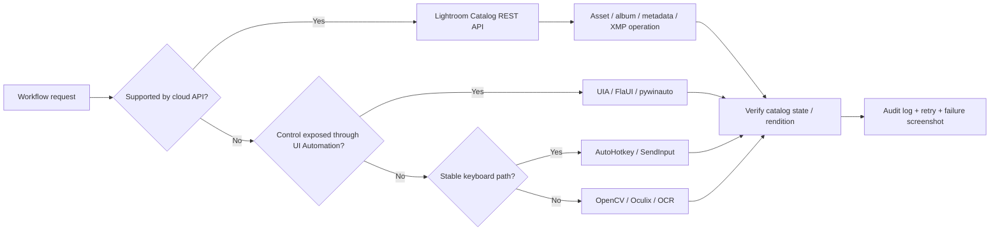
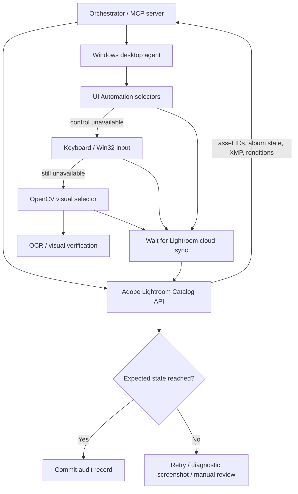
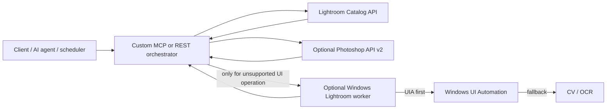

# Automating Adobe Lightroom Cloud on Windows: APIs, MCP, GUI Automation, Windows UIA, Computer Vision, and Hybrid Architectures

## Executive summary

For **Lightroom on Windows—the cloud-based Lightroom application, not Lightroom Classic—the automation landscape is asymmetric**. Adobe exposes useful cloud-facing interfaces, but it does **not** expose a supported local scripting/plugin model comparable to Lightroom Classic's Lua SDK. Adobe's current UXP documentation covers hosts such as Photoshop, Premiere, and InDesign, and Adobe's September 2026 extensibility roadmap explicitly says that Lightroom is *not* part of the Creative Cloud desktop UXP/CEP transition. Lightroom Classic, by contrast, has a documented Lua plug-in SDK. citeturn19view0turn24search3

The most important official interface for cloud Lightroom is therefore the **Lightroom Catalog REST API** at `lr.adobe.io`. It represents Lightroom's cloud catalog, assets, metadata, albums, renditions, and external XMP develop settings. Adobe documentation current in April 2026 continues to describe this API, including partner entitlement, OAuth access to a user's catalog, uploads, rendition generation, and creation of external XMP develop settings either by uploading XMP or copying the develop settings from another asset. citeturn27search2turn27search26turn27search11turn24search2

A critical naming trap exists in 2026: Adobe also had a **different Lightroom image-processing API under Firefly Services**, used for operations such as automated image adjustments. That service reached end of life on **July 31, 2026**, and Adobe tells customers to migrate those imaging workloads to **Photoshop API v2**. That retirement does **not appear to cover the separate cloud Catalog API documented under `developer.adobe.com/lightroom/lightroom-api-docs`**, which still had catalog documentation updated in April 2026. The two surfaces should not be conflated. citeturn26search2turn27search2turn27search8

For local desktop automation, the strongest general-purpose stack is:

**Windows UI Automation → keyboard/shortcut automation → computer vision fallback**, rather than coordinate-only clicking. Microsoft's UI Automation provides semantic elements and patterns across desktop frameworks, while `SendInput`, foreground-window APIs, and image matching can cover controls Adobe does not expose through accessibility. UIA's success with Lightroom must be measured empirically with `Inspect.exe` or an equivalent inspector because Adobe does not document the accessibility structure of Lightroom's custom editing UI. citeturn9search3turn9search31turn23search26

For production systems, the recommended architecture is **hybrid and API-first**:



The practical recommendations are:

| Requirement | Recommended approach |
|---|---|
| **Batch edits and presets** | Use the Lightroom Catalog API when the edit can be represented by external XMP/copy-develop-settings; otherwise drive Lightroom's built-in batch UI with UIA + keyboard shortcuts. For maximum programmable develop-control coverage, consider Lightroom Classic + Lua instead. citeturn24search2turn24search3 |
| **UI-only functions absent from APIs** | Direct UI Automation with FlaUI/C# or pywinauto/Python; fall back to AutoHotkey for shortcuts and OpenCV for visually rendered controls. |
| **Cross-machine/cloud workflows** | Lightroom Catalog API plus your own service/MCP layer. Adobe's official **Adobe for Creativity** connector/MCP is attractive for supported agentic creative operations but should not be assumed to expose every Lightroom catalog or desktop operation. citeturn3view0turn2search7 |
| **Quick personal macros** | AutoHotkey v2, preferably shortcut-first and image matching only where necessary. |
| **Selenium/WebDriver-style testing** | Appium Windows Driver + WinAppDriver if WebDriver compatibility is mandatory, but direct UIA is preferable for a new Lightroom automation project because Microsoft's WinAppDriver server is old even though Appium's proxy driver is still actively released. citeturn10view0turn11search7turn23search17 |
| **Highest reliability across unsupported UI operations** | Hybrid UIA + keyboard + OpenCV/OCR, with API-based state verification after Lightroom sync. |

The fundamental design principle is:

> **Use an API to express intent, UI Automation to manipulate semantics, keyboard automation to exploit stable application commands, and computer vision only to bridge gaps.**

That ordering minimizes sensitivity to window size, DPI, themes, control relocation, and Lightroom UI redesigns.

## Scope, product distinctions, and official Adobe interfaces

The name “Lightroom CC” is historically ambiguous. This report uses it in the sense requested: **the cloud-based Lightroom desktop application on Windows**, whose originals and editing state participate in Adobe's cloud ecosystem. Lightroom Classic is a distinct desktop/catalog-oriented product and has a very different extensibility model. Adobe describes Lightroom as a cloud-based service spanning desktop, mobile, and web, while Lightroom Classic remains the desktop-oriented product. citeturn24search1turn28search17

### Current official surface map

| Interface | Cloud Lightroom on Windows | Lightroom Classic | Status in October 2026 |
|---|---:|---:|---|
| Lightroom Catalog REST API | **Yes, cloud-side** | Not its local `.lrcat` database API | Current Adobe catalog documentation was updated in April 2026. citeturn27search2turn27search8 |
| External XMP develop settings through Catalog API | **Yes** | Separate local mechanisms | Adobe API documentation describes upload and copy-from-asset workflows. citeturn24search2 |
| UXP | **No documented Lightroom host** | No documented Lightroom Classic UXP host | Adobe's September 2026 roadmap explicitly excludes Lightroom from the UXP/CEP transition. citeturn19view0 |
| CEP / ExtendScript / JavaScript plug-in host | **No documented local Lightroom host** | Lua, not CEP/ExtendScript, is the official Classic SDK path | Adobe's current UXP roadmap separates Lightroom from CEP/UXP-supported flagship applications. citeturn19view0 |
| Lua SDK | **No** | **Yes** | Adobe officially provides the Lightroom Classic SDK and says plug-ins are written in Lua. citeturn24search3 |
| Lightroom image-processing API under Firefly Services | Historical cloud service, not local desktop scripting | N/A | **EOL July 31, 2026; migrate to Photoshop API v2.** citeturn26search2 |
| Adobe for Creativity MCP/connector | Cloud/assistant-level integration | Not equivalent to Classic Lua | Available in 2026 with tools spanning Lightroom and other Adobe products. citeturn3view0turn2search7 |
| Lightroom-specific COM Automation object | **No published Adobe interface found** | **No published Adobe COM object found** | Do not design around COM as an application object model; Windows UI Automation itself does use COM internally. citeturn23search33turn9search3 |

**Lightroom Catalog REST API.** Adobe's cloud Lightroom API models a catalog containing a customer's assets, metadata, and media renditions. Applications authenticate users through Adobe IMS/OAuth; the application needs an Adobe API key, access token, and appropriate Lightroom scopes. Adobe says access is available to entitled partner applications after the customer explicitly permits access. citeturn27search2turn27search26turn3view3

Its strongest automation value is not just catalog browsing. Adobe's API reference describes **external XMP develop settings** and two workflows: uploading an XMP settings file for an asset or creating settings by copying another asset's XMP develop settings. That makes preset-like bulk operations possible without touching the Windows GUI when the desired adjustment is representable in the supported develop-settings format. citeturn24search2

The API also supports catalog and asset retrieval, uploads, and rendition workflows. Adobe's upload guidance uses `GET /v2/catalog` to discover the user's catalog and notes that a Lightroom catalog must already exist; rendition generation is documented separately and may be asynchronous. citeturn27search11turn27search14

**Prerequisites:** Adobe Developer integration, partner entitlement, Adobe OAuth, user consent, Lightroom account/catalog, and application infrastructure capable of securely storing credentials/tokens. Upload workflows have additional entitlement/storage requirements. citeturn27search26turn3view3turn4search9

**Capabilities:** catalog and asset management; metadata-oriented workflows; albums/resources exposed in the API; upload; rendition access/generation; external XMP develop settings; cloud synchronization without requiring the Windows desktop application to be visible. citeturn27search17turn27search14turn24search2

**Limitations:** this is a catalog/service interface, not an API for pushing buttons, moving Lightroom sliders interactively, opening arbitrary panels, or manipulating all current AI-editing UI. The exact compatibility of every new Lightroom develop operation—especially newer asset-specific AI/adaptive operations—with portable XMP is not fully specified in the documentation retrieved here and should be treated as **version- and feature-dependent**.

**Reliability/performance:** highest among the options for operations the API actually exposes because it is independent of screen layout and desktop focus. Performance is network- and service-bound, and some rendition operations are asynchronous. citeturn27search14

**Security:** OAuth tokens and application secrets are security-sensitive. Adobe's authentication documentation calls for Lightroom scopes such as `lr_partner_apis` and `lr_partner_rendition_apis` and describes token handling. citeturn3view3

**Maintainability:** high relative to GUI automation because callers target documented resources rather than pixels. The largest operational risk is entitlement/API lifecycle rather than UI redesign.

**Representative workflow:** identify an album and its asset IDs → obtain a reference asset's latest develop settings → copy those settings to a batch → poll catalog revision/rendition state → surface failures for manual review.

**Engineering estimate:** approximately **3–7 developer-days for a proof of concept** once API entitlement is available, and **2–6 weeks for production OAuth, retries, monitoring, auditability, and robust batch processing**. These are engineering estimates, not Adobe estimates.

### The retired Firefly Lightroom API and Photoshop API v2

A separate Lightroom API was distributed through Adobe Firefly Services for image-processing workflows. Adobe announced that this service would reach **end of life on July 31, 2026** and directs customers to migrate to **Photoshop API v2**, saying Adobe is consolidating imaging API capabilities there. Because the current date is October 17, 2026, new systems should not be built against that retired Lightroom service. citeturn26search2turn26search4

This distinction matters when evaluating older examples, tutorials, Zapier integrations, or blog posts that mention “Lightroom API” operations such as Auto Tone, auto-straightening, preset application, or file conversion. Do not assume such examples refer to the still-documented Lightroom **catalog** API. Adobe's migration notice should be the authority for imaging-service operations, while `developer.adobe.com/lightroom/lightroom-api-docs` remains the reference for the Lightroom cloud catalog. citeturn26search2turn27search2

### UXP, JavaScript, Lua, and local plug-ins

UXP is Adobe's modern JavaScript-based plug-in platform. Current UXP documentation describes plug-ins running inside UXP-enabled hosts and points developers to Photoshop, Premiere, Media Encoder, InDesign, and related host APIs. Adobe's September 2026 roadmap states explicitly that “Lightroom” is not affected by the CEP-to-UXP transition. Consequently, there is **no supported UXP route for automating the cloud Lightroom desktop application at present**. citeturn18view1turn19view0

Likewise, no documented ExtendScript/CEP host or JavaScript object model for the cloud Lightroom desktop application was found. JavaScript remains perfectly usable **externally** through Node.js—for REST APIs, MCP servers, WebDriver clients, Windows helper processes, or CV orchestration—but not as an Adobe-supported in-process Lightroom cloud scripting runtime.

Lightroom **Classic** is different. Adobe provides a Lightroom Classic SDK and explicitly states that plug-ins are written in Lua. That route is much more appropriate when you need reliable, programmatic interaction with a desktop Lightroom catalog rather than automation of the cloud application's visible UI. citeturn24search3

## Automation methods in depth

### MCP and agent-oriented automation

Adobe's official **Adobe for Creativity** connector, released in 2026, exposes more than 50 creative tools across products including Photoshop, Lightroom, Illustrator, Firefly, Premiere, Express, InDesign, and Stock. Adobe documents use in Claude environments and describes workflows including portrait retouching and batch photo editing; Adobe sign-in enables additional tools and continuity compared with guest access. citeturn3view0turn2search7

This is significant because it is the closest thing today to an **official Adobe agent/MCP layer**. However, it should be understood as an agent-facing creative-service integration, not a replacement for Windows UI Automation. The retrieved documentation does not establish that every tool manipulates the exact current asset in a user's installed Lightroom desktop UI, exposes arbitrary catalog operations, or supports every Lightroom slider. Those details should be considered **unspecified until verified against the runtime tool registry**. citeturn3view0

**Prerequisites:** supported AI client/environment, Adobe authentication for the expanded experience, network access.

**Capabilities:** natural-language orchestration of supported Adobe creative tools, multi-step creative workflows, and some batch photo operations. citeturn3view0

**Limitations:** tool granularity is constrained to what Adobe publishes through the connector; it does not provide arbitrary low-level desktop control.

**Reliability/performance:** potentially high for supported remote tools; network/service latency dominates rather than local UI timing.

**Security:** treat the MCP tool set as privileged access to creative assets. Agentic systems should use action allowlists, explicit boundaries for destructive changes, and separate read versus write tools.

**Maintainability:** better than pixel automation because the tool contract is semantic, though MCP tool names/schemas can evolve.

**Sample workflow:** user asks an agent to perform a defined batch edit → MCP tool invocation → Adobe service executes operation → result returned or opened in the relevant Adobe application.

**Engineering estimate:** **0.5–2 days** for a proof of concept if the required tools already exist; roughly **1–2 weeks** to add policy, logging, retries, asset validation, and production safeguards.

A third-party option is **Zapier's Adobe Photoshop Lightroom MCP integration**. Zapier currently advertises tools including **Apply AutoTone, Apply Presets, Convert File**, and job-status operations. Zapier says MCP actions use its authentication layer and that a tool call consumes two Zapier tasks. citeturn16view0

Because Zapier abstracts the backend, do not infer that its current implementation uses the retired Firefly Lightroom API; Zapier can change providers or migrate internally. Its advantage is rapid integration; its disadvantages are dependency on Zapier, task consumption, reduced low-level control, and potentially harder debugging.

**Engineering estimate:** hours to one day for a simple proof of concept, several days to a week for guarded production workflows.

Community MCP work is more mature around **Lightroom Classic**, where developers can put a Lua plug-in inside Lightroom and bridge it to an MCP server. The Automaat `lightroom-mcp` project, for example, targets Lightroom Classic and exposes operations such as collections, ratings/keywords, presets, and export; another implementation uses a Python MCP server plus a Lua plug-in exchanging commands. These projects are evidence that MCP + Lua is workable for Classic, but they do **not** create a hidden plug-in API for cloud Lightroom. citeturn15search0turn15search4

For cloud Lightroom, a strong custom design is therefore:

> **MCP server → your service → Lightroom Catalog API**, with separate local-desktop UI tools only for operations the API cannot express.

### External scripting

Python, C#, PowerShell, Rust, and Node.js are all viable orchestration languages because they can sit *outside* Lightroom and call whichever automation layer is appropriate.

A practical division is:

| Language | Particularly good fit |
|---|---|
| **C#/.NET** | Native Windows UI Automation, COM UIA3, Win32/PInvoke, FlaUI |
| **Python** | pywinauto, OpenCV, OCR, REST APIs, orchestration/prototyping |
| **PowerShell** | Process management, Win32/.NET automation, glue scripts |
| **Node.js/TypeScript** | REST APIs, MCP servers, Appium/WebDriver ecosystem |
| **Lua** | Official in-process plug-ins **only in Lightroom Classic**. citeturn24search3 |
| **JavaScript inside Lightroom cloud** | No supported UXP/CEP host found. citeturn19view0 |

External scripts are especially valuable as the **orchestrator**: one Python or C# process can query cloud state, wait for sync, use UIA where possible, call OpenCV where needed, and emit structured logs.

### AutoHotkey

AutoHotkey is well suited to personal or workstation-local Lightroom macros: activating the window, sending shortcuts, navigating menus, clicking locations, and using `ImageSearch` when no semantic selector exists. AutoHotkey's documentation covers window manipulation and control/input automation. citeturn12search0turn12search20

Its strongest pattern is **keyboard first**. A shortcut is far less sensitive to a panel shifting 50 pixels than a coordinate click. Image matching should come after keyboard and window operations.

**Prerequisites:** installed AutoHotkey v2; interactive logged-in desktop; stable Lightroom workspace; template images if using `ImageSearch`.

**Capabilities:** hotkeys, window activation, keystrokes, mouse operations, image search, simple process/window state checks.

**Limitations:** weak semantic understanding of Lightroom's state; coordinate/image automation can break after UI redesign, DPI changes, theme changes, localization, or panel resizing.

**Reliability:** medium for shortcut-based macros, low-to-medium for pure coordinate clicking, medium when image matching and explicit state checks are added.

**Performance:** very fast for keystrokes/window control; image searching is slower and scales with region size.

**Security/permissions:** normally no administrator privilege is needed if Lightroom and the script run at the same Windows integrity level. Windows UIPI blocks lower-integrity input injection into higher-integrity applications, so elevation should be kept consistent. citeturn22search3turn22search23

**Maintainability:** good for ten- or twenty-line shortcut macros; poor for hundreds of pixel-based steps unless you build reusable state/selector abstractions.

**Sample workflow:** activate Lightroom → find the Presets affordance visually → open it → locate a named preset template → click it → detect completion indicator.

**Engineering estimate:** **0.5–2 days** for a useful personal macro, **3–10 days** for a hardened script with recovery and multiple UI states.

### AutoIt

AutoIt occupies a similar niche to AutoHotkey but provides a more conventional scripting environment and a broad library of window/control and pixel operations. Its official functions include pixel searching, and it has long been used for Windows GUI automation. citeturn7search30

The same Lightroom-specific caveat applies: if Lightroom's editing controls are custom-rendered rather than standard Windows controls, AutoIt's `Control*` style methods may not identify them meaningfully; then keyboard/mouse or CV is required.

For a greenfield engineering project, C#/UIA or Python/pywinauto tends to scale better architecturally. AutoIt remains very good for lightweight workstation automation.

### Direct UI Automation, FlaUI, and pywinauto

**Microsoft UI Automation is the preferred Windows-native automation layer.** It represents desktop controls as a tree of `AutomationElement` objects and exposes behavior through control patterns such as Invoke, Value, Selection, RangeValue, Toggle, Scroll, and others. Microsoft provides both managed and COM-facing APIs, with `UIAutomationCore.dll` implementing the infrastructure. citeturn9search3turn9search31

UIA is more robust than pixel automation because it can say, conceptually, “invoke the button named Presets” rather than “click at x=1728, y=214.” Microsoft also exposes UI Automation events, enabling event-driven waits instead of constant polling. citeturn9search24

The gating question is: **what does Lightroom expose?** Adobe does not publish a Lightroom Windows UIA map. Before committing to UIA, inspect the actual application with Microsoft's `Inspect.exe`, Accessibility Insights, FlaUInspect, or pywinauto's control dump. pywinauto specifically recommends comparing what `Inspect.exe` sees in UIA mode when selecting the appropriate backend. citeturn23search26

**FlaUI** wraps Microsoft's UIA2/UIA3 APIs in .NET and is attractive for strongly typed C# automation. Its project supports both generations of Microsoft UI Automation and is actively used for desktop automation. citeturn23search3

**pywinauto** gives Python two major backends: the traditional Win32 backend and Microsoft's UI Automation backend. It is particularly convenient for experiments because it can enumerate controls and print identifiers before you write selectors. citeturn23search2turn23search6

**Prerequisites:** an accessible UIA tree; same interactive Windows session; ideally stable `AutomationId`, control names, or tree relationships.

**Capabilities:** semantic finding, clicking/invocation, reading values/text, selection, scrolling, event-based waits, window/dialog handling.

**Limitations:** a custom-rendered canvas may expose only a few generic containers rather than individual sliders/buttons. UIA cannot invent semantics the application does not expose.

**Reliability:** high when stable IDs/patterns are available; medium or low for unnamed/custom elements.

**Performance:** generally better than visual searching because no screenshot/template scan is needed; event-based waits further reduce polling overhead. citeturn9search24

**Security:** cross-process UI automation is subject to Windows security/integrity boundaries. Microsoft's documentation notes restrictions involving processes started under different `Run as` contexts. citeturn9search3

**Maintainability:** high when selectors use `AutomationId` and stable semantic properties; moderate when selectors depend on English names or exact tree positions.

**Sample workflow:** find Lightroom top-level window → locate Edit/Presets control → invoke it → locate a list/tree item by accessible name → invoke/select → wait for UIA property/state change.

**Engineering estimate:** **1–3 days** to inspect Lightroom and build a proof of concept; **1–3 weeks** for a production-grade state machine, assuming the relevant controls are exposed.

### WinAppDriver, Appium, and Selenium-like desktop automation

Microsoft's **WinAppDriver** provides a Selenium/WebDriver-like service for Windows desktop applications including Win32, WPF, WinForms, and UWP. Its official repository documents a service listening on `127.0.0.1:4723`, use of Developer Mode, and WebDriver-style element operations. citeturn10view0

However, the maintenance picture is mixed. Microsoft's surfaced WinAppDriver release history still points to the 1.2.x era around 2021, making the server a legacy dependency for a new 2026 production platform. citeturn11search7

The **Appium Windows Driver** is much more current—the project had version 6.2.0 released September 10, 2026—but its own documentation says it acts as a proxy to Microsoft's WinAppDriver server. Thus modern Appium client plumbing does not remove the legacy backend dependency. citeturn23search1turn23search17

A newer alternative, **FlaUI.WebDriver**, provides a W3C WebDriver2 layer over FlaUI/UIA3, but its own project describes the implementation as **experimental and not feature-complete**. citeturn22search1

Therefore:

- use WinAppDriver/Appium when your organization has a strong existing Selenium/Appium test ecosystem;
- use direct FlaUI or pywinauto for a new Lightroom automation service;
- treat FlaUI.WebDriver as promising but experimental.

**Prerequisites:** WinAppDriver service and Developer Mode for the Microsoft path; Appium/Node if using Appium; an accessible UIA tree.

**Capabilities:** WebDriver selectors, sessions, clicking, typing, window handling, test-framework integration.

**Limitations:** still dependent on UIA visibility; service round trips add complexity; WinAppDriver server maintenance is a concern.

**Security:** the service is a powerful desktop-control endpoint. Keep it loopback-only unless there is a carefully controlled remote architecture. Microsoft's README notes that changing its listening interface/port may require administrator privileges. citeturn10view0

**Engineering estimate:** **2–5 days** for proof of concept and **2–4 weeks** for hardened automation; more if your Lightroom controls are poorly exposed.

### Win32, Accessibility/MSAA, and COM

The Windows Automation API includes both legacy **Microsoft Active Accessibility (MSAA)** and modern UI Automation. Microsoft positions UIA as the newer accessibility/automation architecture while maintaining interoperability with legacy MSAA through the Windows automation stack. citeturn23search33turn9search3

For Lightroom, useful low-level Win32 functions include:

- window enumeration and HWND discovery;
- `GetWindowRect`/client geometry;
- process identification;
- focus/foreground handling;
- `SendInput`;
- keyboard/mouse injection;
- DPI/monitor coordinate conversion;
- `SendMessage`/`PostMessage` where a conventional HWND-based control actually responds.

`SetForegroundWindow` is not absolute: Windows intentionally restricts applications from stealing the foreground, so code must handle failure instead of assuming it can always focus Lightroom. citeturn8search3

`SendInput` inserts keyboard/mouse events into the system input stream but is explicitly subject to **User Interface Privilege Isolation (UIPI)**; an application can inject input only into processes running at an equal or lower integrity level. citeturn22search3

`SendMessage` is also subject to UIPI, and even where messages can be delivered, a custom-rendered Lightroom widget may have no conventional child HWND that accepts an ordinary `WM_COMMAND` or edit-control message. citeturn22search19

There is no published Adobe Lightroom-specific COM object model comparable to applications such as Microsoft Office. **COM is still relevant because UI Automation's native interfaces are COM-based**, but that is Windows accessibility automation, not an Adobe Lightroom automation object model. citeturn9search3

A low-level Win32-only implementation therefore usually performs worse architecturally than UIA. Use Win32 as infrastructure around UIA—window discovery, focus, screen geometry, input injection—not as the primary semantic interface.

## Computer vision, visual automation, and hybrid systems

### OpenCV template matching

OpenCV's `matchTemplate` function compares a template image against candidate positions in another image and produces a match response from which the best location can be obtained with functions such as `minMaxLoc`. This makes it an excellent fallback when Lightroom visually draws a control but does not expose it through UI Automation. citeturn14search4turn14search20

A typical Lightroom CV operation is:

1. capture only the expected right-side panel region;
2. normalize or account for DPI;
3. match a small template for a button/icon;
4. require a confidence threshold;
5. click the resulting point;
6. verify that the next expected visual state appears.

This is substantially better than fixed coordinates because it tolerates moderate movement.

**Prerequisites:** screen capture, templates for the target UI, known display/theme/DPI assumptions, interactive desktop.

**Capabilities:** buttons/icons/custom canvases, controls completely invisible to accessibility APIs, visual confirmation.

**Limitations:** matching pixels has no semantic understanding. UI scale, font rendering, Lightroom redesigns, monitor scaling, localization, hover states, themes, and subtle icon changes can lower scores. That fragility follows directly from the visual nature of template matching; multi-scale templates and constrained regions mitigate it but do not remove it. citeturn14search4

**Reliability:** low-to-medium as the sole automation method; medium-to-high as a fallback inside a state-aware hybrid system.

**Performance:** depends heavily on image dimensions. Restricting matching to a narrow region of interest is the most important optimization. For comparison, PyAutoGUI's own documentation says full-screen visual location calls on a 1920×1080 screen can take roughly one to two seconds; native OpenCV with small regions can be much faster, but actual timing is hardware- and template-dependent. citeturn14search7

**Security:** screenshots can contain customer photographs, filenames, metadata, faces, and other sensitive material. Avoid persisting full screenshots unless needed for failure diagnostics; encrypt/redact diagnostic artifacts where appropriate.

**Maintainability:** maintain a versioned template library keyed by Lightroom UI version/theme/DPI, and test templates automatically after every application update.

**Engineering estimate:** **1–3 days** for basic matching; **1–3 weeks** for multi-state matching, retry/recovery, multiple displays, DPI handling, and tests.

### SikuliX and Oculix

SikuliX popularized “automate what you see” by combining screenshots with visual pattern matching. Its current project site indicates that original SikuliX development has stopped, while **Oculix** has emerged as an active successor/fork using OpenCV for visual screen interaction. citeturn14search1turn14search5

For a fresh 2026 deployment, OpenCV directly or Oculix is a safer architectural choice than betting on the original SikuliX project's future maintenance.

The advantage over hand-written OpenCV is convenience: visual selectors, clicking, waiting for images, and workflow primitives are already packaged. The disadvantage is less control over matching strategy and an additional framework dependency.

### OCR

Tesseract is a mature open-source OCR engine and remains suitable for reading UI text that Lightroom does not expose semantically. citeturn14search2turn14search10

OCR is most useful for **verification**, for example:

- reading an export-complete message;
- reading a numeric displayed value;
- confirming that a specific preset name is visible;
- extracting an error message after a failed operation.

It is usually a poor first choice for control discovery. UIA text is cheaper and deterministic when available; visual template matching is often better for icons; OCR adds sensitivity to font size, antialiasing, zoom, and background contrast.

### Hybrid API + UIA + CV

The highest-reliability design for cloud Lightroom is not a single technology. It is a **layered automation controller**.



This architecture provides several advantages.

First, the cloud API can act as the **source of truth** for which assets should be processed. A UI macro no longer needs to infer the entire batch merely from thumbnails.

Second, UIA controls the UI semantically whenever possible, eliminating most coordinate dependencies.

Third, computer vision is isolated to a small set of controls known not to expose accessibility semantics.

Fourth, API-visible XMP or new renditions can provide a **postcondition** after Lightroom sync. Adobe's Lightroom integration surface includes retrieval of the latest external XMP develop settings and asset/rendition data, making this form of verification feasible where the edit is represented there. citeturn24search0turn27search14

A particularly strong hybrid batch workflow is:

> **API selects/organizes the target assets → Windows agent navigates Lightroom to that known set → UIA invokes the unsupported editing function → CV handles any inaccessible widget → Lightroom synchronizes → API reads catalog/XMP/rendition state → controller marks the job successful.**

If access to the partner-only Catalog API cannot be obtained, the same local automation stack can still work, but cloud-side state verification must be replaced with UI-based checks, exported-file checks, or other application-visible postconditions.

## Windows automation architecture, reliability, security, and maintenance

The reliability hierarchy for desktop selectors should be:

**stable `AutomationId` → semantic name/control pattern → relative UIA tree relationship → keyboard command → image selector → fixed coordinates.**

Fixed coordinates should be treated as an emergency fallback rather than the foundation.

### Interactive-session constraints

Windows input automation is not equivalent to a headless web browser. GUI workflows normally require a real interactive desktop. UAC/integrity differences, locked desktops, changed RDP state, and elevated target processes can interfere with UI automation or input. Microsoft's Power Automate guidance documents these classes of UIPI/session problems, and `SendInput` itself explicitly enforces integrity-level restrictions. citeturn12search12turn22search3

A production Lightroom workstation should therefore use:

- a dedicated automation user account;
- the same integrity/elevation level for Lightroom and automation software;
- a fixed monitor arrangement and scaling where CV is involved;
- a predictable Lightroom workspace;
- suppression of unrelated pop-ups/notifications where operationally possible;
- explicit detection of Adobe sign-in dialogs, update dialogs, sync failures, and modal errors.

Administrator rights should **not** be made the default solution. Running both applications unelevated at the same integrity level usually minimizes UIPI problems while reducing security exposure. citeturn22search3

### State machines instead of sleeps

Scripts such as:

```text
click
sleep 2000
click
sleep 3000
click
```

are inherently fragile. Prefer:

```text
perform action
wait until expected window/control/image/state exists
if timeout:
    capture diagnostic state
    retry according to policy
otherwise:
    continue
```

UI Automation events are useful when available because Microsoft supports notifications for changes in automation elements and properties. citeturn9search24

A production runner should distinguish at least:

`READY → NAVIGATING → EDITING → WAITING_FOR_SYNC → VERIFYING → COMPLETE`

with explicit states for:

`AUTH_REQUIRED`, `MODAL_DIALOG`, `SYNC_ERROR`, `UI_NOT_FOUND`, and `TIMEOUT`.

### Selector resilience

A stable UIA selector might be:

```text
Window
  -> descendant AutomationId="..."
  -> control type Button
  -> InvokePattern
```

A weaker but still reasonable selector is:

```text
Window
  -> named panel "Presets"
  -> descendant list
  -> list item with expected name
```

A fragile selector is:

```text
the third button inside the second pane
```

and the most fragile is:

```text
Click(1743, 351)
```

Localization is another reason to favor `AutomationId` over visible `Name` properties.

### CV resilience

A visual implementation should never search the entire 4K desktop when it knows that the relevant Lightroom toolbar occupies a 500×100 rectangle.

Use:

- region-of-interest capture;
- separate templates for materially different DPI scales;
- a confidence threshold;
- a secondary visual confirmation;
- “negative” state templates for error dialogs;
- multiple templates where an icon has active/inactive variants.

For controls such as sliders, avoid trying to derive the adjustment solely from pixel position if UIA exposes a `RangeValuePattern`. If it does not, CV plus mouse drag is possible but should be followed by OCR or visual/state verification.

### Maintenance strategy

The primary source of local automation maintenance will be Lightroom UI updates. Treat each Creative Cloud application update like a dependency upgrade:

1. run an automated smoke suite;
2. enumerate/check key UIA selectors;
3. test all CV templates;
4. run representative preset/edit/export workflows;
5. compare before/after states;
6. promote the version to production only after the automation passes.

This transforms “a macro that occasionally breaks” into a managed automation product.

For enterprise-scale use, logs should contain semantic steps, timing, Lightroom/app version, selector used, retries, and final status. Failure screenshots should be opt-in and protected because they can expose customer images.

### Security model by layer

| Layer | Primary risk | Recommended control |
|---|---|---|
| Lightroom REST API | OAuth token/client-secret compromise | Secrets manager; least scopes; encrypted storage; token rotation. Adobe requires authenticated, user-authorized access. citeturn3view3turn27search26 |
| MCP/agent | Agent invokes unintended write operation | Tool allowlists; read/write separation; schema validation; confirmation policy for destructive operations |
| UIA | Automation gains broad access to interactive desktop | Dedicated user/session; process allowlist; least privilege |
| WinAppDriver | Powerful automation service exposed over network | Bind to loopback; firewall; do not expose directly to untrusted networks. citeturn10view0 |
| `SendInput` / AHK | Wrong foreground app receives input | Verify foreground HWND immediately before each destructive input |
| CV/OCR | Screenshots leak photos or metadata | Restrict screenshot region; short retention; encryption/redaction |
| Classic plug-in | Plug-in executes inside Lightroom Classic | Signed/controlled deployment; versioned plug-in; narrow filesystem/network access |

## Implementation blueprints

The examples below are deliberately built around **discoverable selectors and configurable visual assets** rather than assuming undocumented Lightroom internal IDs. Exact Lightroom control names, Automation IDs, executable names, and keyboard commands can differ by release and are therefore marked as values to verify on the target system.

### AutoHotkey v2: window activation plus image-driven fallback

```ahk
#Requires AutoHotkey v2.0

SetTitleMatchMode 2
CoordMode "Pixel", "Screen"
CoordMode "Mouse", "Screen"

; Verify the actual title/executable on the target Lightroom build.
lightroomWindow := "Lightroom"

if !WinExist(lightroomWindow) {
    throw Error("Lightroom window was not found.")
}

WinActivate lightroomWindow

if !WinWaitActive(lightroomWindow, , 3) {
    throw Error("Could not activate Lightroom.")
}

; Restrict visual search to the area where the right-side editing panel
; is expected. These coordinates should be calculated from the actual
; Lightroom window rectangle in a production implementation.
searchLeft   := Floor(A_ScreenWidth * 0.70)
searchTop    := 0
searchRight  := A_ScreenWidth - 1
searchBottom := A_ScreenHeight - 1

template := A_ScriptDir "\templates\presets_button.png"

; *80 permits modest color variation. Tune this empirically.
if ImageSearch(
    &x,
    &y,
    searchLeft,
    searchTop,
    searchRight,
    searchBottom,
    "*80 " template
) {
    ; Click near the center rather than the template's upper-left corner.
    Click x + 12, y + 12
} else {
    throw Error("Presets control was not found visually.")
}

; Do not blindly Sleep for several seconds in production.
; Search for the next expected UI state or window instead.
```

A better production variant obtains Lightroom's actual window rectangle through Win32/UIA and restricts `ImageSearch` to that client area. It should also verify the foreground HWND immediately before the click because Windows can deny or redirect foreground activation under some circumstances. citeturn8search3turn22search3

Where Lightroom provides stable keyboard shortcuts, replace visual navigation with those shortcuts and use `ImageSearch` only to confirm that the requested panel/state was reached.

### C# UI Automation: invoke an accessible Lightroom control

```csharp
using System;
using System.Windows.Automation;

public static class LightroomUi
{
    public static void InvokeNamedControl(IntPtr lightroomHwnd, string accessibleName)
    {
        if (lightroomHwnd == IntPtr.Zero)
            throw new ArgumentException("Invalid Lightroom window handle.");

        AutomationElement root = AutomationElement.FromHandle(lightroomHwnd)
            ?? throw new InvalidOperationException(
                "Could not create a UI Automation root for Lightroom.");

        var condition = new AndCondition(
            new PropertyCondition(
                AutomationElement.NameProperty,
                accessibleName),
            new PropertyCondition(
                AutomationElement.IsEnabledProperty,
                true)
        );

        AutomationElement? element =
            root.FindFirst(TreeScope.Descendants, condition);

        if (element is null)
            throw new InvalidOperationException(
                $"Accessible element '{accessibleName}' was not found.");

        if (element.TryGetCurrentPattern(
                InvokePattern.Pattern,
                out object? pattern))
        {
            ((InvokePattern)pattern).Invoke();
            return;
        }

        throw new InvalidOperationException(
            $"Element '{accessibleName}' exists but does not expose InvokePattern.");
    }
}
```

The call might conceptually be:

```csharp
LightroomUi.InvokeNamedControl(lightroomHwnd, "Presets");
```

but **“Presets” is only an illustrative accessible name**. The actual Lightroom UIA tree should first be inspected using Microsoft's `Inspect.exe`, FlaUInspect, Accessibility Insights, or pywinauto. UIA patterns are explicitly designed to expose a control's functionality independently of its visible appearance. citeturn9search3turn9search31turn23search26

Production code should prefer:

```text
AutomationId + ControlType + expected pattern
```

over visible names wherever Lightroom supplies a stable ID.

When invocation fails because no pattern is available, a controlled fallback can use the element's bounding rectangle and `SendInput`, then confirm the resulting UI state.

### Python/OpenCV: region-based template matching

```python
from __future__ import annotations

import time
from pathlib import Path

import cv2
import numpy as np
import pyautogui
from PIL import ImageGrab


def find_template(
    template_path: Path,
    roi: tuple[int, int, int, int],
    threshold: float = 0.90,
) -> tuple[int, int, float] | None:
    """
    Find a template inside a screen region.

    roi is (left, top, right, bottom) in physical screen pixels.
    Returns absolute screen x/y at the template center plus confidence.
    """
    if not template_path.is_file():
        raise FileNotFoundError(template_path)

    left, top, right, bottom = roi

    screenshot = np.array(
        ImageGrab.grab(bbox=(left, top, right, bottom))
    )

    # PIL produces RGB. OpenCV convention is BGR.
    screen_bgr = cv2.cvtColor(screenshot, cv2.COLOR_RGB2BGR)

    template = cv2.imread(str(template_path), cv2.IMREAD_COLOR)
    if template is None:
        raise RuntimeError(f"Could not load template: {template_path}")

    th, tw = template.shape[:2]

    if screen_bgr.shape[0] < th or screen_bgr.shape[1] < tw:
        raise ValueError("Search region is smaller than the template.")

    response = cv2.matchTemplate(
        screen_bgr,
        template,
        cv2.TM_CCOEFF_NORMED,
    )

    _, max_score, _, max_location = cv2.minMaxLoc(response)

    if max_score < threshold:
        return None

    rel_x, rel_y = max_location
    center_x = left + rel_x + tw // 2
    center_y = top + rel_y + th // 2

    return center_x, center_y, float(max_score)


def click_template(
    template_path: Path,
    roi: tuple[int, int, int, int],
    threshold: float = 0.90,
) -> None:
    match = find_template(template_path, roi, threshold)

    if match is None:
        raise RuntimeError(
            f"Template not found above threshold {threshold:.2f}"
        )

    x, y, score = match
    print(f"Matched at ({x}, {y}), confidence={score:.3f}")

    pyautogui.click(x, y)


if __name__ == "__main__":
    # Example only. Compute this from Lightroom's HWND in production.
    right_panel_roi = (1400, 100, 1915, 1050)

    click_template(
        Path("templates/preset_name.png"),
        right_panel_roi,
        threshold=0.92,
    )

    # Replace this with a visual/UIA state wait in production.
    time.sleep(0.2)
```

OpenCV officially documents the `matchTemplate` + `minMaxLoc` approach used here. citeturn14search4turn14search20

For a hardened implementation, add:

- two or three scale variants per template;
- monitor/DPI detection;
- grayscale or edge-based templates where appropriate;
- an exclusion mask for dynamic thumbnail areas;
- a second template confirming the post-click state;
- a maximum retry count.

### Lightroom Classic Lua plug-in skeleton

This example is intentionally labeled **Lightroom Classic only**. The cloud Lightroom Windows application cannot load `.lrplugin` packages through this SDK. Adobe officially documents Lua as the Lightroom Classic plug-in language. citeturn24search3

`Info.lua`:

```lua
return {
    -- Set this to the minimum SDK version required by your real plugin.
    LrSdkVersion = 6.0,

    LrToolkitIdentifier = "com.example.lightroom.automationbridge",
    LrPluginName = "Automation Bridge",

    LrLibraryMenuItems = {
        {
            title = "Run Automation Bridge Command",
            file = "Bridge.lua",
        },
    },
}
```

`Bridge.lua`:

```lua
local LrApplication = import "LrApplication"
local LrDialogs = import "LrDialogs"
local LrTasks = import "LrTasks"

LrTasks.startAsyncTask(function()
    local catalog = LrApplication.activeCatalog()
    local photos = catalog:getTargetPhotos()

    LrDialogs.message(
        "Automation Bridge",
        string.format("Received %d selected photo(s).", #photos)
    )

    -- Production implementations can:
    --
    -- 1. inspect selected photos through supported SDK APIs;
    -- 2. call supported Classic catalog/develop functions;
    -- 3. exchange structured commands with an external process;
    -- 4. return status to an MCP or local orchestration service.
    --
    -- Verify every Lightroom Classic SDK call against the SDK version
    -- installed with the target Lightroom Classic release.
end)
```

Community Lightroom Classic MCP projects demonstrate the natural extension of this pattern: an MCP/Python process accepts semantic commands and a Lua plug-in bridges those commands into Lightroom Classic. citeturn15search0turn15search4

This is often the cleanest answer when a requirement evolves from “automate a few UI tasks” into “build a programmable Lightroom workstation.” If cloud Lightroom specifically is mandatory, however, the Lua route is unavailable.

### Cloud API pseudocode for batch develop settings

Because the precise external-XMP resource path should be taken from Adobe's current live API reference rather than hard-coded from an older sample, the safest implementation pattern is:

```python
# Pseudocode: Lightroom cloud Catalog API

token = oauth_login(
    scopes=[
        "openid",
        "AdobeID",
        "lr_partner_apis",
        "lr_partner_rendition_apis",
    ]
)

headers = {
    "Authorization": f"Bearer {token}",
    "X-API-Key": ADOBE_CLIENT_ID,
}

catalog = GET("/v2/catalog", headers=headers)

source_asset = choose_reference_asset(catalog)

# Fetch latest external XMP develop settings for source_asset.
reference_xmp = get_latest_develop_xmp(
    catalog_id=catalog.id,
    asset_id=source_asset.id,
)

for target_asset in batch:
    # Use the current API-reference operation that creates an asset's
    # external XMP develop settings, either:
    #
    # A) upload XMP, or
    # B) copy another asset's external XMP settings.
    create_external_develop_settings(
        catalog_id=catalog.id,
        asset_id=target_asset.id,
        copy_from=source_asset.id,
    )

wait_for_catalog_revision_or_rendition()
verify_batch()
```

Adobe documents `GET /v2/catalog`, partner/OAuth access, and the upload-or-copy external-XMP workflows. citeturn27search11turn27search26turn24search2

For large batches, design the operation as an idempotent job queue: record source asset, source develop-settings revision, target IDs, requested action, completion revision, and retries.

## Comparison, development effort, and recommended designs

The ratings below are engineering judgments for Lightroom automation, not vendor benchmarks. “Robustness” means resistance to UI/layout changes **for the operations the method supports**. “Speed” measures automation overhead, not Lightroom's actual image-rendering time.

| Method | Robustness | Automation speed | Ease of development | Privileges / access | Direct software cost | Maintenance | Best fit |
|---|---|---|---|---|---|---|---|
| **Lightroom Catalog REST API** | **Very high** | High / network-bound | Medium-low | Adobe partner entitlement + OAuth | Adobe/API terms unspecified | Low-medium | Cloud catalog, metadata, assets, XMP batch edits |
| **Photoshop API v2** | Very high for its exposed imaging ops | Network-bound | Medium | Adobe service auth | Service pricing/terms apply | Low-medium | Successor to retired Firefly Lightroom imaging API. citeturn26search2 |
| **Adobe for Creativity MCP** | High for exposed tools | Medium | **High** | AI client + Adobe auth for full capability | Platform/Adobe terms vary | Medium | Agentic creative workflows. citeturn3view0 |
| **Zapier Lightroom MCP** | Medium-high | Medium | **Very high** | Zapier + Adobe auth | Zapier task usage; two tasks/tool call documented | Low-medium | Fast business/workflow integration. citeturn16view0 |
| **Lightroom Classic Lua SDK** | **Very high** | **High** | Medium | Lightroom Classic; no admin normally | Included with product/tooling | Low-medium | Deep programmatic desktop Lightroom—but Classic only. citeturn24search3 |
| **Direct UIA / FlaUI** | High if controls exposed | **High** | Medium | Interactive session; matching integrity level | Free/open-source tooling | Medium | Best local cloud-Lightroom GUI layer |
| **pywinauto UIA** | High if controls exposed | High | Medium-high | Interactive Windows session | Free/open-source | Medium | Python-centric automation. citeturn23search2 |
| **AutoHotkey** | Medium | **Very high** for shortcuts | **Very high** | Same integrity as target | Free | Medium-high | Personal macros, shortcut-heavy workflows |
| **AutoIt** | Medium | High | High | Same integrity as target | Freeware | Medium-high | Similar niche to AHK |
| **Appium + WinAppDriver** | Medium | Medium | Medium | Developer Mode; automation service | Free | **High** due legacy server | Existing WebDriver/Appium organizations. citeturn10view0turn23search1 |
| **FlaUI.WebDriver** | Medium | Medium | Medium | UIA access | Free/open-source | Medium-high | Experimental WebDriver-over-UIA. citeturn22search1 |
| **OpenCV template matching** | Low-medium alone; medium-high as fallback | Medium | Medium | Visible interactive desktop | Free/open-source | **High** | Custom-drawn UI inaccessible through UIA |
| **Oculix/Sikuli-style vision** | Medium | Medium | High | Visible desktop | Free/open-source | Medium-high | Rapid visual automation; Oculix preferable to dormant SikuliX. citeturn14search1turn14search5 |
| **OCR/Tesseract** | Low-medium | Low-medium | Medium | Screenshot access | Free/open-source | High | State/value verification, not primary control |
| **UIA + keyboard + CV + API hybrid** | **Highest practical** | High overall | Low initially | OAuth + interactive desktop | Mostly engineering cost | **Medium once built** | Production automation covering API and UI gaps |

Estimated effort for **one experienced Windows/Python/C# automation engineer**, assuming Lightroom and required Adobe access already exist:

| Approach | Proof of concept | Hardened production implementation | Complexity |
|---|---:|---:|---|
| Catalog API integration | 3–7 days | 2–6 weeks | Medium-high |
| Adobe/MCP-supported workflow | 0.5–2 days | 1–2 weeks | Low-medium |
| Zapier MCP | Hours–1 day | 3–7 days | Low |
| AutoHotkey macro | 0.5–2 days | 3–10 days | Low-medium |
| UIA/FlaUI/pywinauto | 1–3 days | 1–3 weeks | Medium |
| Appium/WinAppDriver | 2–5 days | 2–4 weeks | Medium-high |
| OpenCV visual workflow | 1–3 days | 1–3 weeks | Medium |
| Classic Lua plug-in | 2–5 days | 2–4 weeks | Medium-high |
| Full API/UIA/CV hybrid | 3–7 days | 3–8 weeks | High initial, best long-term coverage |

These ranges exclude Adobe partner-approval time, enterprise security review, deployment packaging, and unknown effort to map the UI by hand if Lightroom exposes little useful accessibility information.

**For batch edits and presets**, the preferred order is:

**Lightroom Catalog API/XMP → Lightroom built-in batch editing controlled by UIA → Classic Lua if switching products is acceptable.**

The Catalog API is the best fit when a reference image's develop state can be copied to other assets or when XMP directly expresses the required edits. Adobe's API explicitly supports copying an asset's external XMP develop settings to another asset. citeturn24search2

If the required adjustment is only available in Lightroom's current desktop UI—particularly a new AI feature—use UIA to select the batch and invoke the feature, with keyboard commands and CV only where necessary. Verify the result after cloud synchronization rather than trusting that a click succeeded.

For an organization that needs extensive, stable, programmable desktop editing rather than specifically cloud Lightroom, **Lightroom Classic should be seriously evaluated**, because its official Lua SDK provides an extensibility layer that cloud Lightroom currently lacks. citeturn24search3

**For UI-driven tasks not exposed by APIs**, use:

**FlaUI/C# or pywinauto → keyboard shortcuts → OpenCV → OCR.**

Do not begin with WinAppDriver solely because it resembles Selenium. Its WebDriver model is attractive, but Microsoft's underlying server has much greater lifecycle risk than direct use of current Windows UI Automation. Appium's Windows Driver is actively maintained in 2026, but it still proxies to that Microsoft server. citeturn23search17turn23search1

For very small personal workflows, AutoHotkey is the exception: the lower development overhead can outweigh its weaker abstraction. A five-step shortcut macro does not need an enterprise UIA framework.

**For cross-machine and cloud workflows**, use a service architecture:



The machine running Lightroom should become an **exception worker**, not the central data plane. Catalog operations, job state, authentication, and orchestration belong in a network service; only genuinely UI-only commands should be dispatched to a Windows worker.

A custom MCP server is particularly compelling here because each tool can represent a safe, high-level business operation rather than a raw mouse click:

```text
list_album_assets(album_id)
apply_reference_develop_settings(source_asset, target_assets)
generate_rendition(asset_id)
open_batch_in_desktop(album_id)
apply_ui_only_feature(feature, selected_assets)
verify_sync(asset_ids)
```

That semantic boundary gives an AI agent far less opportunity to make an accidental destructive desktop action.

### Overall recommendation

For a new system targeting **cloud Lightroom on Windows in late 2026**, I would build the stack as follows:

**Core:** a Python, TypeScript, or C# orchestration service using the **Lightroom Catalog API** for catalog/asset/XMP operations. Obtain partner entitlement before making this dependency central. citeturn27search26

**Desktop worker:** C# with **FlaUI/UIA3** if Windows automation is the primary engineering focus, or Python with **pywinauto UIA** if integration with image-processing/CV code matters more. Both map directly to Microsoft's semantic automation infrastructure. citeturn23search2turn23search3

**Input fallback:** use **AutoHotkey or `SendInput`** for stable keyboard shortcuts and simple input paths, with rigorous foreground-window checks because Windows focus and UIPI rules apply. citeturn8search3turn22search3

**Visual fallback:** native **OpenCV template matching**, restricted to small regions and followed by visual/UIA verification. Use Tesseract only when text must be recovered from a visual-only area. citeturn14search4turn14search2

**Agentic layer:** expose the above as a narrow custom MCP server, or use **Adobe for Creativity** directly when its published Lightroom/creative tools already perform the desired operation. citeturn3view0

**Do not make these foundational dependencies:** fixed screen coordinates; the retired Firefly Lightroom imaging API; a hypothetical Lightroom UXP plug-in host; a hypothetical Lightroom COM automation object; or WinAppDriver unless existing WebDriver infrastructure materially justifies its legacy backend. citeturn26search2turn19view0turn10view0

**Reference documentation and project links**

| Resource | Link |
|---|---|
| Adobe Lightroom cloud/catalog developer documentation | [Adobe Lightroom API](https://developer.adobe.com/lightroom/lightroom-api-docs/) citeturn27search2 |
| Lightroom API reference | [Adobe Lightroom API Reference](https://developer.adobe.com/lightroom/lightroom-api-docs/api/) citeturn27search17 |
| Lightroom API getting started / entitlement | [Start building with Lightroom APIs](https://developer.adobe.com/lightroom/lightroom-api-docs/getting-started/) citeturn27search26 |
| Firefly Lightroom API retirement | [Lightroom API deprecation announcement](https://developer.adobe.com/firefly-services/docs/lightroom/getting-started/deprecation-announcement/) citeturn26search2 |
| Adobe current UXP documentation | [UXP Guides](https://developer.adobe.com/uxp/guides/) citeturn18view1 |
| Lightroom Classic Lua SDK | [Adobe Lightroom Classic SDK](https://developer.adobe.com/lightroom-classic/) citeturn24search3 |
| Microsoft UI Automation | [Windows Automation API / UI Automation](https://learn.microsoft.com/en-us/windows/win32/winauto/windows-automation-api-overview) citeturn23search33 |
| Microsoft WinAppDriver | [Microsoft WinAppDriver repository](https://github.com/microsoft/WinAppDriver) citeturn10view0 |
| Appium Windows Driver | [Appium Windows Driver](https://github.com/appium/appium-windows-driver) citeturn23search1 |
| pywinauto | [pywinauto](https://github.com/pywinauto/pywinauto) citeturn23search2 |
| FlaUI | [FlaUI](https://github.com/FlaUI/FlaUI) citeturn23search3 |
| OpenCV template matching | [OpenCV template matching tutorial](https://docs.opencv.org/) citeturn14search4 |
| Adobe for Creativity | [Adobe for Creativity connector](https://www.adobe.com/) citeturn3view0 |
| Community Lightroom Classic MCP example | [Automaat/lightroom-mcp](https://github.com/Automaat/lightroom-mcp) citeturn15search0 |

The main architectural conclusion is that **cloud Lightroom is best automated as a cloud service with a desktop compatibility layer, not as a scriptable Windows application**. Adobe's Catalog API gives the cleanest supported route for catalog and XMP-capable operations; Windows UI Automation provides the strongest semantic desktop fallback; computer vision closes the unavoidable accessibility gaps; and MCP is best used above those layers to expose safe, task-level operations rather than to turn an AI agent directly into a mouse-and-keyboard driver.